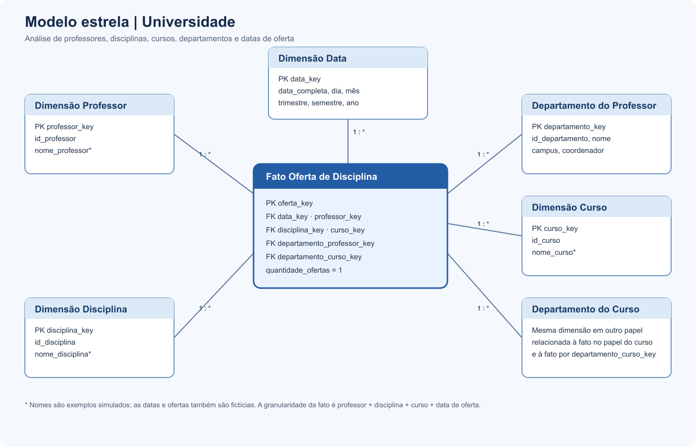
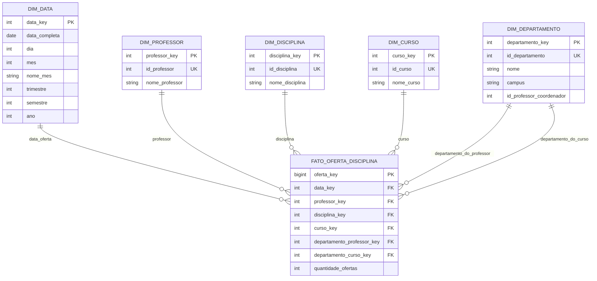

# Modelagem dimensional — Universidade

## Objetivo

Criar um modelo dimensional em estrela para analisar professores, disciplinas ministradas, cursos e departamentos. O modelo parte do diagrama relacional disponibilizado no enunciado. As tabelas de alunos e matrículas ficam fora do escopo, conforme solicitado.

## Diagrama visual

## Granularidade da tabela fato

**Uma linha por professor, disciplina, curso e data de oferta.**

No diagrama relacional, a relação entre disciplina e curso está na tabela associativa **Disciplina & Curso**, e cada disciplina referencia um professor. Portanto, a base da fato é formada por:

`Professor → Disciplina → Disciplina & Curso → Curso`

O esquema original não apresenta uma tabela de oferta nem qualquer coluna de data. Para demonstrar o modelo completo, `dados_simulados.sql` inclui exemplos fictícios de ofertas e datas. Esses valores são apenas ilustrativos e não representam registros reais da universidade ou do curso.

## Diagrama estrela

`DIM_DEPARTAMENTO` aparece em dois papéis na fato: o departamento ao qual o professor pertence e o departamento responsável pelo curso. No Power BI, pode-se duplicar a consulta da dimensão com nomes como **Departamento do Professor** e **Departamento do Curso** para manter os dois relacionamentos ativos e fáceis de entender.

## Tabelas do modelo

### Fato `fato_oferta_disciplina`

Guarda o contexto analisado. As chaves conectam cada registro às dimensões de data, professor, disciplina, curso e departamentos. `quantidade_ofertas` vale 1 por linha e permite contar ofertas. O identificador da oferta é uma chave técnica; ele não representa uma informação que aparecia no esquema de origem.

### Dimensões

- **Data:** data completa, dia, mês, nome do mês, trimestre, semestre e ano.
- **Professor:** identificador de origem e nome.
- **Disciplina:** identificador e nome.
- **Curso:** identificador e nome.
- **Departamento:** identificador, nome, campus e identificador do coordenador, conforme o diagrama de origem.

Os nomes e as ofertas da carga de exemplo são inventados para demonstrar as relações e os visuais. Substitua-os por valores reais se receber a base da universidade.

## Dados simulados incluídos

A carga de demonstração contém 3 departamentos, 5 professores, 6 cursos, 6 disciplinas, 12 datas e 12 ofertas fictícias. Algumas ofertas conectam departamentos diferentes para mostrar a distinção entre o departamento do professor e o departamento do curso.

## Mapeamento da origem

| Origem relacional | Destino dimensional |
|---|---|
| `Professor.idProfessor` | `dim_professor.id_professor` |
| `Professor.Departamento_idDepartamento` | papel Departamento do Professor |
| `Disciplina.idDisciplina` | `dim_disciplina.id_disciplina` |
| `Disciplina.Professor_idProfessor` | professor relacionado à disciplina |
| `Disciplina & Curso.Disciplina_idDisciplina` | ligação com a disciplina |
| `Disciplina & Curso.Curso_idCurso` | ligação com o curso |
| `Curso.idCurso` | `dim_curso.id_curso` |
| `Curso.Departamento_idDepartamento` | papel Departamento do Curso |
| `Departamento.idDepartamento`, `Nome`, `Campus` | `dim_departamento` |
| Data de oferta | exemplo fictício em `dados_simulados.sql` |

As tabelas `Aluno`, `Matriculado` e `Pré-requisitos das disciplinas` não entram nesta análise centrada no professor.

## Medidas e análises possíveis

- quantidade de ofertas de disciplinas;
- quantidade de cursos por professor;
- quantidade de disciplinas por professor;
- ofertas por departamento do professor e por departamento do curso;
- ofertas por mês, semestre ou ano.

O esquema apresentado não contém carga horária, salário, nota ou frequência. Essas medidas não devem ser calculadas sem obter os respectivos dados.

## Como executar

1. Execute `modelo_estrela.sql` em uma instância MySQL para criar o banco `universidade_dw` e as tabelas vazias.
2. Execute `dados_simulados.sql` para inserir a carga fictícia de demonstração.
3. No Power BI, conecte cada dimensão à fato pela respectiva chave, usando o lado `1` na dimensão e `*` na fato.
4. Para uso com dados reais, substitua os exemplos fictícios e valide os nomes das colunas no banco de origem.

> Os dados e datas incluídos são simulados e servem apenas para demonstrar a modelagem. Não são dados reais do curso ou de uma instituição.

